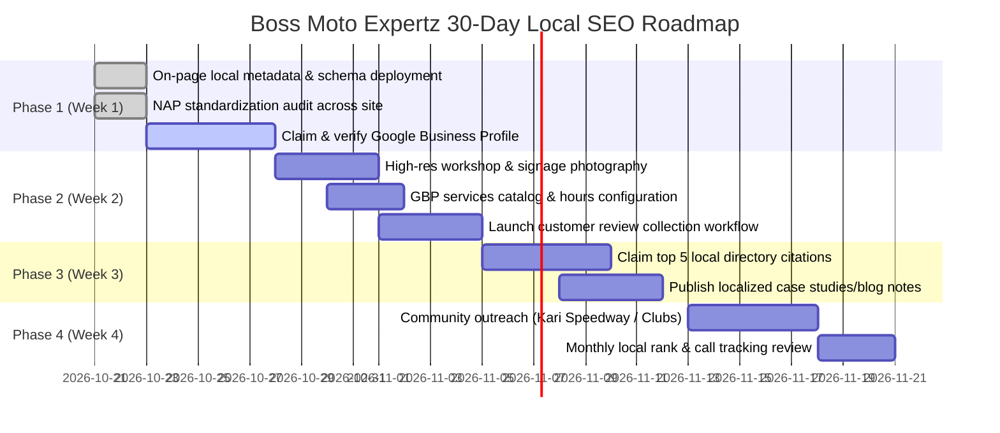

# Local SEO Optimization Plan: Boss Moto Expertz

**Business:** Boss Moto Expertz  
**Primary Industry:** Motorcycle & Superbike Performance Studio / Repair Workshop  
**Physical Address:** 42, Amarar Jeeva Main Road, Nalvar Layout, Coimbatore, Tamil Nadu, India  
**Verified Phone:** [+91 63 799 299 63](tel:+916379929963)  
**Coordinates:** 11.0268° N, 76.9634° E  
**Operating Hours:** Monday – Saturday: 9:00 AM – 7:00 PM | Sunday: Based on Appointment  
**Website:** [index.html](file:///c:/Users/gurus/Boss-Moto-expertz/index.html)  

---

## 1. Executive Summary & Client Information Analysis

### Core Services
1. **Periodic Maintenance & Oil Servicing:** 40-point safety audits, Motul/Castrol premium oil changes, filter replacements, chain slack and lube, brake bleeding.
2. **Engine Overhaul & Mechanical Repair:** Bore kit installations, valve clearance adjustments, clutch plate overhauls, gearbox troubleshooting, noise diagnostics.
3. **ECU Remapping & Advanced Diagnostics:** OBD-II scanning, error code diagnosis, fuel-map calibration, dyno-tuning, throttle response optimization, speed limiter unlocking.
4. **Custom Builds & Modifications:** Cafe racers, scramblers, bobbers, track prep, custom chassis fabrication, free-flow exhausts.
5. **Specialist Paint & Detailing:** 3-coat OEM paint matching, custom airbrush artwork, ceramic quartz coating, frame powder coating, chrome restoration.
6. **Suspension & Brakes:** Inverted fork rebuilds, fork seal replacement, rear monoshock setup, steel-braided line installation, sintered pad upgrades.

### Target Customers
- **Commuter Riders Seeking Precision Work:** Owners of Royal Enfield (Classic/Hunter/Himalayan), Yamaha (MT-15, R15), KTM (Duke/RC), Honda, Bajaj (Pulsar/Dominar), and TVS (Apache) seeking expert diagnostics beyond crowded dealerships.
- **Superbike & Twin-Cylinder Enthusiasts:** Owners of Kawasaki (Ninja/Z-series), Triumph, BMW Motorrad, Suzuki, Harley-Davidson looking for certified diagnostics, dyno work, and track prep.
- **Vintage & Classic Restorers:** Enthusiasts reviving 2-stroke icons (Yamaha RX100, RD350) and vintage cast-iron Royal Enfields.

### Service Locations
- **Primary Hub:** Nalvar Layout, Amarar Jeeva Main Road, Coimbatore.
- **Immediate Neighborhoods:** Peelamedu, Gandhipuram, RS Puram, Race Course, Ramanathapuram, Saibaba Colony, Saravanampatti, Singanallur, Ganapathy, Town Hall, Kuniyamuthur, Vadavalli.
- **Regional Radius (Kongu Belt):** Tirupur, Pollachi, Erode, Mettupalayam, and riders visiting Kari Motor Speedway (Chettipalayam).

### Local Search Intent
- **High Transactional Intent:** Users with immediate service needs searching for nearby workshops ("bike service near me", "motorcycle mechanic in coimbatore", "royal enfield service center coimbatore").
- **Commercial Investigation Intent:** Superbike owners researching specialized care ("superbike mechanic coimbatore", "ecu tuning coimbatore", "rx100 restoration in coimbatore").
- **Informational Intent:** Inquiries regarding operating hours, service turnaround, pricing policy ("are bike workshops open on sunday in coimbatore", "bike service cost based on condition").

---

## 2. Keyword Mapping Matrix

| Target Page | Primary Keyword | Secondary / Near-Me Keywords | Search Intent | Implementation Status |
| :--- | :--- | :--- | :--- | :--- |
| **Home (`index.html`)** | motorcycle service workshop in coimbatore | bike service near me, superbike workshop coimbatore, two wheeler repair coimbatore | High Commercial / Transactional | ✅ Implemented in Title, Meta, Schema, Hero |
| **Services (`services.html`)** | bike repair services in coimbatore | ecu tuning coimbatore, royal enfield mechanic coimbatore, custom bike modifications coimbatore | Transactional / Informational | ✅ Implemented in Title, Meta, Local Hub & FAQ Schema |
| **Contact (`contact.html`)** | motorcycle workshop in coimbatore | bike mechanic nalvar layout, boss moto expertz coimbatore address, bike repair phone number coimbatore | Navigational / Direct | ✅ Implemented in Title, Meta, Schema, NAP Blocks |
| **Booking (`booking.html`)** | book motorcycle service online coimbatore | bike service appointment coimbatore, superbike service booking | Transactional | ✅ Implemented in Title, Meta, Schema |
| **Brands (`brands.html`)** | superbike brands serviced in coimbatore | ktm service coimbatore, yamaha service coimbatore, bmw motorrad mechanic coimbatore | Commercial Investigation | ✅ Implemented in Title, Meta, Schema |
| **About (`about.html`)** | motorcycle mechanics coimbatore | certified bike technicians coimbatore, superbike specialist team coimbatore | Informational / Trust | ✅ Implemented in Title, Meta, Schema, Team Cards |
| **Gallery (`gallery.html`)** | custom motorcycle builds coimbatore | rx100 restoration coimbatore, bike paint shop coimbatore, custom bobber builder tamil nadu | Visual / Commercial | ✅ Implemented in Title, Meta, Schema |

---

## 3. On-Page Optimizations Implemented

1. **Title Tags & Meta Descriptions:**
   - Standardized all 9 page titles and descriptions to include natural geographic signals ("Coimbatore", "Nalvar Layout") and eliminated previous formatting errors (corrupted `""` or special characters).
2. **Local Content Hub in `services.html`:**
   - Added a dedicated **Local Workshop Coverage Section** detailing service delivery across Central Coimbatore (Gandhipuram, RS Puram, Race Course), the IT Corridor (Peelamedu, Saravanampatti, TIDEL Park), and the Kongu Track & Tour Zone (Kari Motor Speedway, Tirupur, Pollachi).
3. **Structured Headings:**
   - Preserved single `<h1>` hierarchy on every page with semantic `<h2>` and `<h3>` tags containing natural local context without keyword stuffing.
4. **Internal Navigation Consistency:**
   - Contextual linking between service categories, supported brands, booking forms, and workshop directions.

---

## 4. NAP & Operating Hours Consistency Baseline

The following NAP details have been verified and made identical across all website pages and footers:

| Field | Client-Confirmed Standard | Verified Locations |
| :--- | :--- | :--- |
| **Business Name** | **Boss Moto Expertz** | Header brand, all page titles, footer copyrights, schema markup |
| **Address** | **42, Amarar Jeeva Main Road, Nalvar Layout, Coimbatore, Tamil Nadu** | Contact page, footer contact items, Google Maps embedded link, schema markup |
| **Phone** | **+91 63 799 299 63** | Direct call links (`tel:+916379929963`), WhatsApp action buttons (`wa.me`), footer items |
| **Operating Hours** | **Mon – Sat: 9:00 AM – 7:00 PM Sunday: Based on Appointment** | All 9 page footers, contact page workshop hours table, Schema.org `OpeningHoursSpecification` |

---

## 5. Structured Data (Schema.org JSON-LD)

Implemented valid JSON-LD on key target pages:

### 1. `MotorcycleRepairShop` (LocalBusiness Subtype)
- Validated on: `index.html`, `services.html`, `contact.html`, `about.html`.
- Properties included:
  - `@type`: `MotorcycleRepairShop`
  - `name`: "Boss Moto Expertz"
  - `telephone`: "+916379929963"
  - `address`: `42, Amarar Jeeva Main Road, Nalvar Layout, Coimbatore, Tamil Nadu, IN`
  - `geo`: `latitude: 11.0268, longitude: 76.9634`
  - `hasMap`: Google Maps pin link
  - `openingHoursSpecification`: Mon–Sat 09:00–19:00, Sunday by appointment
  - `areaServed`: Coimbatore
  - `priceRange`: `₹₹`
  - `sameAs`: Verified Instagram and YouTube social profiles

### 2. `FAQPage` Schema
- Validated on: `services.html`.
- Covers real customer questions (workshop address, supported brands, ECU tuning, Sunday appointment policy, transparent pricing based on vehicle condition, and online booking).

---

## 6. Google Business Profile (GBP) Setup & Optimization Checklist

> [!IMPORTANT]
> **Client Authorization Required:** Google Business Profile creation, ownership claiming, or administrative edits cannot be made without direct client authorization. The checklist below outlines the exact actions the business owner should take.

### A. Core Profile Configuration
- [ ] **Exact Business Name:** Register as `Boss Moto Expertz` (do not add extra keywords like "Best Bike Service" to avoid suspension).
- [ ] **Primary Category:** `Motorcycle repair shop`
- [ ] **Secondary Categories:** `Motorcycle shop`, `Motorsports store`, `Motor vehicle repair shop`.
- [ ] **Address:** `42, Amarar Jeeva Main Road, Nalvar Layout, Coimbatore, Tamil Nadu` (ensure pin matches 11.0268, 76.9634).
- [ ] **Service Area:** Add Coimbatore and adjacent regions (Peelamedu, RS Puram, Gandhipuram, Saravanampatti, Singanallur, Pollachi, Tirupur).
- [ ] **Operating Hours:**
  - Mon–Sat: 9:00 AM – 7:00 PM
  - Sunday: Marked as "Open by appointment" (or set special hours).
- [ ] **Primary Phone:** `+91 63 799 299 63`
- [ ] **Website URL:** `https://bossmotoexpertz.com` (with appointment link pointing to `/booking.html`).

### B. Visual Asset Strategy
- [ ] **Exterior & Entrance:** 3 high-resolution photos of the workshop exterior showing the Boss Moto Expertz signboard clearly so customers and Google Street View can verify the physical storefront.
- [ ] **Interior & Workbays:** High-resolution photos of clean hydraulic bike lifts, organized diagnostic stations, and tool bays.
- [ ] **Team & Action Photos:** Real photos of technicians performing ECU scans, engine overhauls, and custom paintwork.

### C. Services & Menu Setup
- [ ] Configure the GBP "Services" tab with categorized offerings matching the website:
  - *Periodic Maintenance & Oil Change*
  - *Engine Overhaul & Mechanical Repair*
  - *Superbike ECU Diagnostics & Dyno Tuning*
  - *Custom Bike Fabrication & Cafe Racer Builds*
  - *Ceramic Coating & Detailing*
  - *Suspension Rebuild & Brake Service*

### D. Review Management Protocol
- [ ] Send direct review links to happy customers following vehicle delivery.
- [ ] Respond to all reviews (both positive and negative) within 24 to 48 hours in a professional tone without repeating generic boilerplate text.

---

## 7. Customer FAQs (Integrated On-Page & Schema)

The following real customer questions have been built into `services.html` with native HTML `
`/`
` accordion components and `FAQPage` structured data:

1. **Where is Boss Moto Expertz located in Coimbatore?**
   - *Answer:* 42, Amarar Jeeva Main Road, Nalvar Layout, Coimbatore, Tamil Nadu, with quick connectivity to Avinashi Road, Peelamedu, and Gandhipuram.
2. **What motorcycle brands do you service at your workshop?**
   - *Answer:* Certified service across Royal Enfield, KTM, Yamaha, Honda, TVS, Bajaj, Kawasaki, Suzuki, BMW Motorrad, Triumph, Jawa, and classic 2-stroke restorations (RX100, RD350).
3. **Do you offer superbike ECU tuning and diagnostics in Coimbatore?**
   - *Answer:* Yes, utilizing specialized OBD and ECU diagnostic scanners for sensor error clearing, fuel-map calibration, and throttle response optimization.
4. **Are you open on Sundays?**
   - *Answer:* Monday to Saturday: 9:00 AM – 7:00 PM. Sundays are strictly by appointment for emergency repairs, weekend tour prep, and custom deliveries.
5. **How are service estimates calculated?**
   - *Answer:* Transparently based on actual vehicle condition, genuine parts required, and labour needed, rather than arbitrary fixed package markups.
6. **How do I book a service appointment?**
   - *Answer:* Online through the Book Service page, via WhatsApp at +91 63 799 299 63, or by direct phone call.

---

## 8. Internal Linking & Legitimate Local Backlink Opportunities

### Useful Internal Linking Patterns
- **Services Catalog to Brand Cards:** Linking service category pages to brand-specific capabilities (e.g., pointing ECU tuning readers to supported KTM/Kawasaki/BMW diagnostic specs).
- **Service Pages to Online Booking:** High-visibility contextual action buttons linking each service package to `booking.html`.
- **Workshop Experience to Google Maps Pin:** Clear external directions link pointing directly to the Google Maps navigation pin.

### Legitimate Local Backlink Opportunities (No Spam / No PBNs)
1. **Local Automotive Directories:**
   - Justdial (Coimbatore listing under "Motorcycle Repair & Services")
   - Sulekha Coimbatore ("Two Wheeler Repair & Services")
   - IndiaMART (Verified automotive services catalog)
2. **Motorcycle Clubs & Riding Groups:**
   - Partner with local riding groups based in Coimbatore (e.g., Coimbatore Royal Enfield Clubs, Kongu Superbike Club, weekend riding groups heading to Valparai and Kotagiri).
   - Offer pre-ride safety inspection camps before major group rides.
3. **Motorsport & Track Events:**
   - Kari Motor Speedway (Chettipalayam, Coimbatore): Explore technical support or paddock mechanic listings for local track day participants and grassroots racing events.
4. **Local Educational Institutions & Tech Parks:**
   - Explore corporate employee motorcycle clinic listings with nearby tech hubs (e.g., TIDEL Park Coimbatore, CHIL SEZ Saravanampatti).
5. **Supplier & Brand Feature Opportunities:**
   - Request listings as an authorized dealer or installer on official partner websites (e.g., Motul India workshop locator, brake pad and filter distributors).

---

## 9. 30-Day Phased Local SEO Action Plan

### Week 1: Foundation & Technical Baseline (Completed in Codebase)
- Deploy location-optimized Title Tags, Meta Descriptions, and OpenGraph data across all pages.
- Implement and validate Schema.org `MotorcycleRepairShop` and `FAQPage` JSON-LD.
- Audit and standardize Name, Address, Phone, and Opening Hours (Mon–Sat 9AM–7PM, Sunday by appointment) across all pages.
- Client action: Initiate Google Business Profile verification postcard/video.

### Week 2: Google Business Profile Optimization & Visual Assets
- Complete GBP profile: categories, attributes, verified phone, address pin.
- Upload 15+ real workshop photos (exterior signage, service bays, diagnostic scanners, team at work).
- Configure GBP direct messaging and automated welcome response.
- Print QR code review cards for the billing desk.

### Week 3: Citations & Local Directorial Outreach
- Submit verified business profile to core local directories (Justdial, Sulekha, IndiaMART).
- Audit consistency of Name, Address, and Phone across all external mentions.
- Set up Google Search Console with sitemap indexing.

### Week 4: Community Engagement & Performance Review
- Connect with local Coimbatore motorcycle rider clubs for pre-tour safety check partnerships.
- Review Google Business Profile Insights (calls, direction requests, website clicks).
- Evaluate top search queries in Google Search Console to refine local keyword targets.

---

## 10. Separation of Completed Changes vs. External Actions

### ✅ Completed in Website Codebase
- [x] Standardized title tags with location signals (`Coimbatore`, `Nalvar Layout`) on all 9 pages.
- [x] Updated meta descriptions with verified address, services, and phone number.
- [x] Added `MotorcycleRepairShop` JSON-LD structured data to `index.html`, `services.html`, `contact.html`, and `about.html`.
- [x] Added `FAQPage` JSON-LD structured data to `services.html`.
- [x] Added interactive customer FAQ section in `services.html`.
- [x] Added Local Service Coverage section in `services.html` covering key Coimbatore neighborhoods and the Kongu region.
- [x] Verified 100% NAP and Sunday "Based on Appointment" consistency across all footers, headers, tables, and scripts.
- [x] Verified mobile accessibility and touch target compliance across all local components.

### 📋 External Actions Requiring Client Action / Approval
1. **Google Business Profile Ownership:** Claim and verify the physical listing on `google.com/business` using the client's official Google account.
2. **Physical Signboard Verification:** Ensure the physical storefront signage at 42, Amarar Jeeva Main Road matches "Boss Moto Expertz".
3. **Directory Submissions:** Authorize phone number verification for local citations on Justdial, Sulekha, and local automotive portals.
4. **Customer Review Protocol:** Provide QR codes at the customer reception area encouraging authentic reviews from riders after completed service.
5. **Rider Club & Track Partnerships:** Reach out to local Coimbatore rider groups and event coordinators at Kari Motor Speedway for official technical partnership opportunities.
